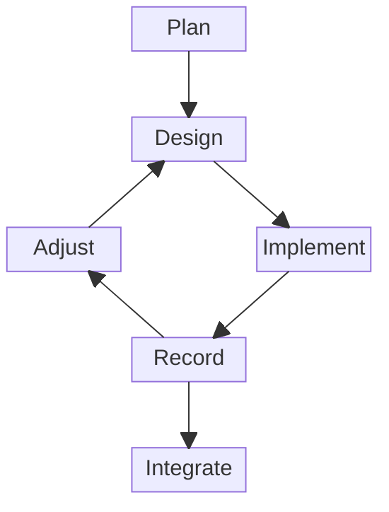

# Contributing

These guidelines only describe what no tool checks: the conventions enforced by configuration files or by the checks of pull requests are not restated, and the messages of the checks explain how to fix failures.
AI agents also follow [`AGENTS.md`](AGENTS.md).

## Principles

These principles guide every contribution:

- Keep every decision auditable: record its rationale once, where it belongs (the RFC for a design decision, the commit message for a change), and link to it elsewhere.
- Before adopting a new approach, check how established projects solve the same problem.
- Cite the source of every claim about other work (papers, documentation, languages, projects) with a link on its name in the text, so that it can be checked.
- Keep everything consistent: file layout, naming, wording and terms.
  When a convention or a term changes, apply it everywhere it is used in the same change.
- Never choose a solution that increases debt of any kind: technical, documentation, consistency or process.
  The extra work a better solution requires is not a reason to settle for a worse one.
  When some debt cannot be avoided, make it explicit in an issue.
- Favor the default configuration of tools and widely established conventions; only deviate from them with a clear reason, documented where the deviation is made.

## Style

Every text of the repository follows this style:

- Write in US English: documentation, comments, commit messages, issues and pull requests.
- In Markdown files, write one sentence per line, without wrapping lines at a fixed length, so that editing a sentence only changes its own line.
  A sentence too long to read on one line is probably too long.
- Give every section of a Markdown file, whatever its level, at least one sentence of its own before its first subsection, which tells what the section holds.
- Introduce every list, table and figure with a sentence before it.
- Sort alphabetically the lists whose order has no meaning.
- Start the README with one short sentence saying what the repository is, and copy it verbatim as the description of the repository on GitHub.

## Workflow

Work on a subject starts with Plan, then goes through iterations that each design, implement, record and adjust a part of it, and Integrate takes what an iteration records.

The steps outside the repositories are free, and those inside them are constrained:

- Plan, Design and Adjust happen outside the repositories, in whatever way suits the contributors, alone or in a group, with or without tools.
  - Plan is a good time to get an overall view of the subject: its scope, its risks and their countermeasures, its decisive problems and their possible solutions.
    The academic literature, the practice of other projects, experiments and prototypes can help, and writing them down helps more than keeping them in mind.
  - Design can do the same for one iteration, sized to be easy to review, with the aim of deciding rather than exploring what is possible.
  - Adjust is the moment to revise the plan, from the results, the problems and the solutions of the iteration, and to rethink it when the iterations do not fit together.
- Implement, Record and Integrate happen in the repositories, through pull requests that follow this guide and pass the checks.
  Every pull request is opened as a draft and stays one until Integrate.
  - Implement changes one or more repositories, with one pull request per repository, but no RFC.
    When it reveals a gap in an RFC, such as a missing case or a definition the implementation needs and the RFC lacks, raise it at once in the pull request, rather than working around it or changing the RFC silently to fit the implementation.
  - Record writes in an RFC of the [rfcs](https://github.com/sic-lang/rfcs) repository what the implementation of the iteration confirmed, and only that iteration.
    Except to fix an RFC, implement first.
    An iteration may have nothing to record, which is fine: the point is to ask whether it has.
  - Integrate starts when the submitter judges a pull request ready, and only then: they mark it ready for review and ask an integrator to review and merge it.
    When the integrator asks for changes, the submitter adds them to the pull request; when the integrator judges it not relevant to the project, it is closed.

Contributors may use AI or any other tool to prepare their pull requests, and bear full responsibility for what they submit, whatever tools they used.
Only an integrator decides to integrate a pull request, never an AI or a tool, which may assist them and perform the merge they decided; the integrator bears full responsibility for accepting or rejecting it.

## Formalization

The Lean package of `theory/` has two libraries: `Sic/`, where each concept has a module `Sic/<Concept>.lean` for its definitions, its properties and its meaning, as the RFCs state them, and `SicExample/`, for the examples.
An example of an annex of an RFC or of the literature has a module named after it in the directory of the concept it illustrates, such as `SicExample/Core/` for an example of the core.
Every definition of an RFC has a definition of `Sic/` with the same structure and the same cases, and every named formula a theorem, so that a reader compares them side by side; the Lean only adds what its representation of variables needs, such as de Bruijn indices and their renamings, and says so in a comment.
A declaration of `Sic/` that formalizes definitions, formulas or rules of the RFCs gives their names on a line of its doc string that starts with `RFC:`, each in a code span, written exactly as in the RFC, inside its parentheses, such as ``RFC: `\mathsf{op}_p` ``; a formula that the representation of variables makes needless, such as a freshness condition with de Bruijn indices, is given to the declaration of this representation, whose doc string says why.
A declaration of `Sic/` names its counterparts in the formalizations that `Sic/` follows, with their files, or `none`, in comments above its doc string, such as ``-- ADE: `wkEq`, in `Definition/Typed/Weakening.agda`.``, which the [README](README.md) relates to the commits of these formalizations, while the header of its module says how the module differs from them.
These comments are not doc strings, since the documentation would make links of the names of these formalizations whenever a declaration of Sic has the same name.
Every file is a module of the [module system of Lean](https://lean-lang.org/doc/reference/latest/Source-Files-and-Modules/), so that a module only passes on the imports it declares public: an import is private, unless the type of a public declaration mentions what it imports (`public import`).
The modules of `Sic/` import only what their concepts need: [`theory/imports.toml`](theory/imports.toml) groups them by subject and states, with its reason, each separation between concepts, such as a judgment that has no premise of another, as a rule on the imports, direct or not, which the check `imports` enforces; a new separation adds a rule there.
A directory without a module of its own groups the concepts of one proof, such as `Sic/Core/Reducibility/` for the logical relation.
The declarations of a module of `Sic/` are in the namespace of its directory, such as `Sic.Core` for `Sic/Core/Typing.lean`, except those on a type of another namespace, which are in the namespace of that type so that its dot notation finds them.
The declarations are public and expose their bodies (`@[expose] public section`), so that the other modules compute with them, and the documentation shows the statements that check a definition beside it.
A proof only shows what its statement says, so a definition is checked against the examples of its RFC and of the literature, and against its meaning when one exists.
The Lean of the repository is the evidence for what Sic claims, and its kernel checks the proofs, so a reader only has to check the definitions and the statements: keep them simple enough that a reader convinces themselves easily that they say what is meant.
A proof may take any form the kernel accepts, but explain in the file how it works when its tactics do not show it.
In the definitions and the statements, write the parentheses wherever the associativity or the precedence of an operator decides the meaning, as in the associativity `(p + q) + r = p + (q + r)` and the distributivity `p * (q + r) = (p * q) + (p * r)`.

## Pull Requests

Pull requests follow these rules:

- The merge queue merges a pull request with a merge commit once its merge with `main` passes the checks, and the commits it brings are exactly the ones that were reviewed.
- Never rewrite the history of a pull request once pushed: make every change, including those asked by the review, a new commit, meaningful on its own, so that the review stays readable.
- A pull request needs no update from `main`, since the merge queue checks its merge with `main`.
  When it conflicts with `main`, merge `main` into it (`git merge --signoff origin/main`) and resolve the conflict in that merge commit.

## Development Environment

Install [Nix](https://nixos.org/), with flakes enabled, on Linux (x86_64 or aarch64) or macOS (Apple silicon).
`nix develop` provides every tool the checks use, at the versions of the nixpkgs commit pinned by `flake.lock`.
With [direnv](https://direnv.net/), `.envrc` loads it when entering the repository, once allowed with `direnv allow` after reading it.

`nix run '.#setup'` runs every setup you confirm, and `nix run '.#setup-<name>'` one of them, which writes recommended files without overwriting one that differs from them, unless given `--force`: the files are then yours to customize, and the checks enforce what they recommend.
The setups write these files:

- `setup-hooks` copies the Git hooks to the hooks of the clone: `commit-msg` rejects a commit without the sign-off of its author, which the `commits` check requires.
- `setup-vscode` writes the recommended extensions and settings of VS Code to `.vscode/`, which Git ignores.

## Checks

`nix run '.#check'` runs every check of the pull requests, and `nix run '.#check-<name>'` one of them, such as `nix run '.#check-reuse'`.

## Site

`nix run '.#build-site'` builds into `book/` the site that GitHub Pages publishes at each push to `main`, to read it as it will be published, from `book/index.html`: the book of the correspondence between the RFCs and the formalization, whose pages `theory/Correspondence.lean` writes, with each formula of the RFCs and the source of the declarations that formalize it, after a page of how many of the names of each page are formalized, the graph of the imports of the modules of `Sic/` with the rules of their imports, which `theory/Imports.lean` writes, and the documentation of the metatheory, which `nix run '.#docs'` generates with [doc-gen4](https://github.com/leanprover/doc-gen4), in `book/theory/`.
The flake pins the commit of the RFCs whose names the pages list: `nix flake update rfcs` follows their changes.

## Developer Certificate of Origin

By signing off a commit, you certify that you have the right to submit it under the license of the repository, as described by the [Developer Certificate of Origin 1.1](https://developercertificate.org/).

Trailers end the commit message, sorted alphabetically (e.g. `Co-Authored-By`, then `Signed-off-by`): write the other trailers at the end of the message, and let `git commit -s` add the sign-off after them.
